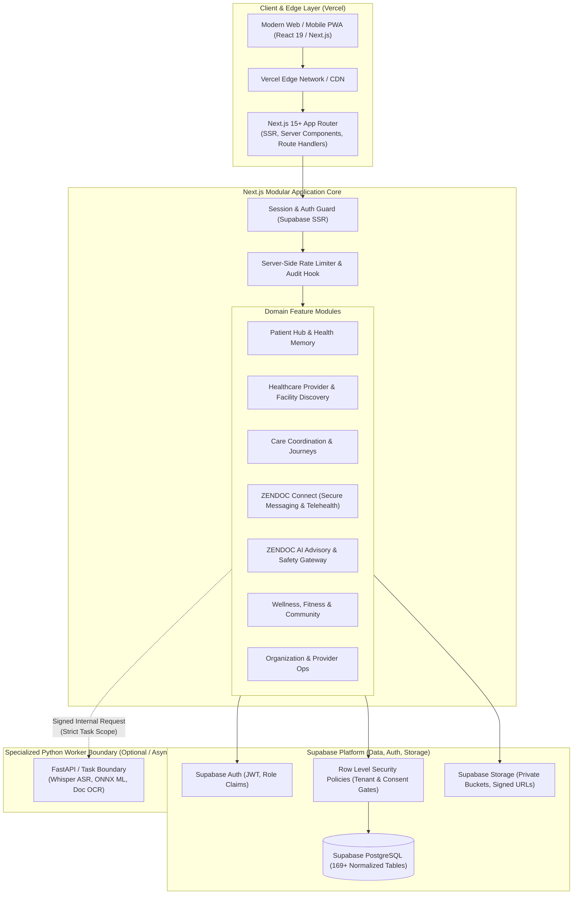

# ZENDOC 2.0 — Target Architecture & System Blueprint

**Product:** ZENDOC 2.0 (AI-Powered Healthcare Coordination Platform)  
**Document version:** 2.0.0  
**Target runtime:** Next.js (App Router, TypeScript) on Vercel + Supabase (PostgreSQL, Auth, Storage, RLS)  
**Branch:** `rebuild/zendoc-2.0-vercel` (tracking `origin/rebuild/zendoc-2.0-vercel`)  
**Status:** Authoritative Rebuild Blueprint  

---

## 1. Executive Summary & Purpose

ZENDOC is an AI-powered healthcare coordination platform dedicated to empowering patients, families, healthcare providers, and organizations to manage personal health records, discover validated care, coordinate end-to-end appointments and services, access deterministic and safety-gated AI guidance, and streamline complex clinical workflows.

This architecture transitions ZENDOC from a single-server Python Flask application hosted on IaaS (AWS EC2 / OCI compute with reverse-proxy Vercel gateways) to a **production-grade Next.js modular monolith** deployed natively on **Vercel**, backed by **Supabase PostgreSQL, Supabase Auth, Supabase Storage, and Row Level Security (RLS)**.

### Architectural Core Principles
1. **Modular Monolith**: Colocated App Router architecture for seamless developer ergonomics, atomic deployments, and low operational overhead.
2. **Zero External Origin Gateway**: Eliminates the fragile reverse proxy (`vercel.ts` rewriting to AWS/OCI origins) in favor of native Next.js Server Components, Server Actions, and Route Handlers.
3. **No IaaS Vendor Lock-in**: Full retirement of AWS EC2, OCI Compute, Render, and custom Caddy reverse proxies for primary web/app traffic.
4. **Supabase as Unified Data & Auth Platform**: PostgreSQL with strict Row Level Security (RLS), Supabase Auth with secure JWT/cookie sessions, and Supabase Storage for private, encrypted health records with short-lived signed URLs.
5. **Decoupled Python Execution Boundary**: Python is retained strictly as an optional specialized service boundary for heavy ML, audio processing (e.g. Whisper ASR), and complex document OCR. No permanent Flask web monolith is maintained.
6. **Safety First, Advisory AI**: Deterministic emergency-triage gates always precede nondeterministic LLM routing. Autonomous diagnosis, prescribing, and emergency dispatch are strictly disabled.

---

## 2. High-Level System Architecture

---

## 3. Layered Module Architecture

### 3.1 Presentation & UI Layer (`src/app/` & `src/components/`)
- **App Router**: Colocated layout, loading, error, and page trees for Patients (`/patient`), Providers (`/provider`), Organizations (`/organization`), Platform Owners (`/admin`), and Public Discovery (`/find-care`, `/shop`, `/community`).
- **Design System**: Built on Tailwind CSS, Radix UI primitives, Lucide icons, with high-contrast accessibility (WCAG AA/AAA compliant) and mobile-first touch optimization.
- **Server Components by Default**: Zero client-bundle overhead for data fetching, static layout rendering, and security boundary enforcement. Client components (`"use client"`) reserved strictly for interactive forms, rich chat, media controls, and map interactions.

### 3.2 Application Services & Server Actions (`src/actions/` & `src/lib/services/`)
- **Server Actions**: Type-safe mutations with automatic revalidation, CSRF protection, and server-side Zod validation.
- **API Route Handlers**: REST/JSON endpoints for secure webhooks, background jobs, external integrations, and partner endpoints (`src/app/api/...`).
- **Context & Consent Engine**: Every request evaluates who is acting, for whom, for what purpose, and retrieves the minimum necessary data subset (`min_bundle`).

### 3.3 Domain Logic Modules
1. **Patient App & Health Memory**: Longitudinal health timelines, verified and user-reported vitals, lab reports, prescriptions, and cryptographic audit records.
2. **Provider Discovery**: Geospatial and categorical search across verified clinicians, hospitals, clinics, and diagnostic labs. Truthful status: No fabricated ratings, distances, or slots.
3. **Care Coordination Engine**: Structured workflows for Diagnostic Bookings, Home Healthcare, Medical Transport requests, and Family Caregiver access grants.
4. **ZENDOC AI Engine**:
   - Deterministic Emergency Guardrail (Red Flag triage prior to any LLM execution).
   - Model Router (Privacy-tiered routing: local/metadata vs. cloud LLM).
   - Tool Execution Registry with Human Approval Gates (Cryptographic plan hashes).
   - Approved Medical Knowledge Base / RAG pipeline.
5. **ZENDOC Connect**: End-to-end authenticated messaging, consultation rooms, WebRTC signaling exchange, attachment security, and abuse reporting.
6. **Wellness, Community & Commerce**: Mental wellness tracking, fitness logs, moderated health community, and non-fabricated Health Shop merchant redirects.

---

## 4. Data & Persistence Architecture

### 4.1 Supabase PostgreSQL
- Replaces legacy SQLite fallback and self-hosted PostgreSQL instances on AWS EC2 / OCI.
- Relational schema preserving all 169 tables and 18 historical migration capabilities into normalized PostgreSQL DDL.
- Strong typing, foreign key constraints, check constraints, composite unique indexes, and audit timestamps.

### 4.2 Row Level Security (RLS) Policy Design
- **Default Deny**: All tables enforce RLS (`ALTER TABLE ... ENABLE ROW LEVEL SECURITY;`).
- **Tenant & Subject Isolation**: Policies verify `auth.uid()` against resource ownership, organization membership, or active consent grants (`consent_grants`).
- **Role Scopes**: Dedicated access policies for `patient`, `provider`, `org_admin`, and `platform_admin`.

### 4.3 Supabase Storage
- Private buckets: `medical-records`, `lab-reports`, `prescriptions`, `consultation-attachments`.
- Public/CDN bucket with upload rate limiting: `community-media`, `provider-avatars`.
- Ephemeral signed URLs (lifetime: 5 to 15 minutes) generated server-side for authenticated users with active consent.

---

## 5. Python Execution Boundary

Python is **strictly decoupled** from the web/API runtime. The Flask application is **not** deployed as a permanent web backend on Vercel.

| Workload | Implementation Boundary | Protocol | Fallback |
|---|---|---|---|
| Audio Transcription (Whisper) | Dedicated Python Micro-service / Serverless GPU | Authenticated HTTP (mTLS / HMAC token) | Client Web Speech API or manual user entry |
| Complex Document OCR | Python Tesseract / PyMuPDF pipeline | Asynchronous Task Queue / Webhook | Plain PDF / Image storage with manual review |
| Specialized Local SLM / ONNX | Local edge device (EdgeCare on Snapdragon) | Local HTTP endpoint (localhost only) | Cloud LLM advisory fallback with consent |

Any operation executable in TypeScript/Node.js (e.g. data validation, scheduling, business logic, RAG embeddings via pgvector, orchestration, rule-based triage) is executed directly within Next.js.

---

## 6. Infrastructure Retirement & Migration

### AWS / OCI / Render Decommissioning Matrix
- **AWS EC2 & Docker Compose (`deploy/aws/compose.yaml`)**: RETIRED in favor of Vercel Serverless.
- **OCI Compute & Caddy (`deploy/oci/compose.yaml`)**: RETIRED.
- **Render (`render.yaml`, `deploy/render-public.example.yaml`)**: RETIRED.
- **Vercel Reverse-Proxy Gateway (`vercel.ts`)**: REPLACED with native Next.js application.
- **boto3 / AWS S3**: REPLACED with Supabase Storage SDK.

---

## 7. Technology Stack Summary

| Layer | Technology | Purpose |
|---|---|---|
| **Framework** | Next.js 15+ (App Router) | Server-side rendering, API routes, Server Actions |
| **Language** | TypeScript 5.5+ (Strict) | End-to-end type safety, schema validation |
| **Styling** | Tailwind CSS 3.4+ | Accessible, responsive, maintainable healthcare UI |
| **Database** | PostgreSQL 15+ (Supabase) | ACID relational data store, full-text search, RLS |
| **Auth** | Supabase Auth (SSR) | Secure session cookies, OAuth, passwordless, RBAC |
| **Object Storage**| Supabase Storage | Encrypted private medical documents, signed URLs |
| **Validation** | Zod | Runtime input validation for forms and API routes |
| **Icons** | Lucide React | Consistent, accessible clinical iconography |
| **Testing** | Vitest / Playwright / Jest | Unit, integration, security, and end-to-end test suites |
| **Deployment** | Vercel | Global edge delivery, automated CI/CD preview branches |

---

## 8. Architectural Invariants & Non-Negotiables
1. **Autonomous Prescribing Forbidden**: Prescription issuance requires verified clinician credentialing and explicit human signature.
2. **Deterministic Emergency Triage**: Chest pain, acute dyspnea, stroke signs, and severe bleeding trigger immediate emergency diversion (102/108/911/999) before any AI generation.
3. **Zero Fabricated Availability**: Provider schedules, lab test pricing, medicine inventory, and distances must reflect verified records or explicitly display `UNCONFIRMED` / `INTEGRATION_REQUIRED`.
4. **Data Minimization**: AI models never receive full longitudinal records when task-specific summaries or structured metadata suffice.
5. **Immutable Audit Ledger**: Access to any health record produces an append-only audit event capturing actor, timestamp, patient ID, purpose, and authorization token.
