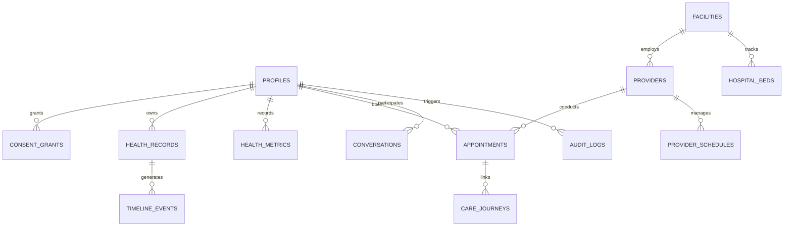

# ZENDOC 2.0 — PostgreSQL Database Architecture & Schema Design

**Product:** ZENDOC 2.0  
**Document version:** 2.0.0  
**Target Engine:** Supabase PostgreSQL 15+ with Row Level Security (RLS) and PostGIS  
**Status:** Authoritative Database Architecture Specification  

---

## 1. Architectural Overview & Migration Objectives

The ZENDOC 2.0 database architecture transitions from an ad-hoc SQLite/PostgreSQL hybrid layer in `zendoc/db.py` to a **fully normalized, enterprise-grade Supabase PostgreSQL relational database**.

### Core Requirements
1. **Preserve Domain Capabilities**: All 169 functional tables and 18 historical migration capabilities from the Python backend are normalized and logically partitioned.
2. **Native Supabase Auth Integration**: All user identities tie directly to `auth.users(id)` with a public extension table `public.profiles`.
3. **Mandatory Row Level Security (RLS)**: Every single table in the `public` schema has RLS enabled with explicit policies for `SELECT`, `INSERT`, `UPDATE`, and `DELETE`.
4. **Referential Integrity & Consistency**: Enforce strict foreign key constraints, `ON DELETE RESTRICT` or `ON DELETE CASCADE` where appropriate, `NOT NULL` constraints, check constraints, and composite unique keys.
5. **High-Performance Geospatial Queries**: Leverage PostGIS (`geography(Point, 4326)`) and GIST indexes for ultra-fast radius searches across healthcare facilities and providers, replacing CPU-heavy Python haversine math.
6. **Immutable Audit Ledger**: Medical modifications, AI tool executions, and consent changes trigger automated append-only audit entries.

---

## 2. Logical Domain Partitioning

The schema is organized into ten cohesive logical domains:



### Domain 1: Identity, Users & Profiles
- `profiles`: Extends `auth.users`, storing role (`patient`, `provider`, `org_admin`, `platform_admin`, `caregiver`), full name, phone number, date of birth, blood group, emergency contact, and eKYC verification status.
- `user_roles`: Multi-tenant role mappings and administrative delegations.
- `api_tokens`: Authenticated B2B / partner API keys with scope constraints and expiration dates.

### Domain 2: Consents & Family Care
- `consent_grants`: Explicit, revocable authorization records specifying grantor, grantee, purpose, permitted data scope, and expiry timestamp.
- `family_members`: Family circle definitions linking dependents (children, elderly parents) to guardian accounts.
- `family_access_grants`: Proxy permission scopes defining which health records a family caregiver may view or edit.

### Domain 3: Healthcare Discovery & Provider Network
- `facilities`: Hospitals, nursing homes, diagnostic centers, and clinics with PostGIS geographic coordinates, address, license number, and verified status.
- `provider_profiles`: Clinician profiles containing registration number (e.g. Medical Council registration), primary specialty, qualifications, biography, languages spoken, and verification evidence status.
- `provider_schedules`: Weekly availability recurring templates with slot duration and breaks.
- `doctor_availability`: Concrete date-specific slot allocations with booking status (`available`, `reserved`, `booked`, `cancelled`).
- `verified_reviews`: Clinician reviews restricted to patients with completed, verified consultation encounters.

### Domain 4: Health Memory, Medical Records & Vitals
- `medical_records`: Metadata for uploaded clinical documents (prescriptions, lab tests, discharge summaries) referencing encrypted private storage objects, SHA-256 hashes, and extraction status.
- `health_metrics`: Time-series vitals (systolic/diastolic BP, heart rate, blood glucose, SpO2, temperature, body weight) tagged with provenance (`USER_REPORTED`, `PROVIDER_RECORDED`, `DEVICE_RECORDED`).
- `health_timeline_events`: Unified chronological healthcare journal uniting appointments, medications, vitals, and diagnostic tests.
- `prescriptions` & `prescription_items`: Structured medication orders containing dosage, frequency, route, duration, and prescribing clinician signature.

### Domain 5: Care Coordination & Service Workflows
- `appointments`: Clinical consultation bookings with status lifecycle (`requested`, `confirmed`, `in_consultation`, `completed`, `cancelled`, `no_show`).
- `diagnostic_catalog`: Standardized pathology and radiology test menu with preparation instructions.
- `diagnostic_bookings`: Home sample collection or lab visit booking orders with report linking.
- `pharmacy_orders`: Medicine fulfillment orders connecting digital prescriptions to registered pharmacies.
- `ambulance_requests`: Non-emergency patient transport and emergency ambulance dispatch state machine.
- `care_journeys` & `care_journey_events`: Longitudinal episode tracking (e.g., Maternity Care, Post-Cardiac Rehabilitation).

### Domain 6: ZENDOC Connect & Real-time Communications
- `conversations`: Group and 1-on-1 secure messaging channels between patients, caregivers, and providers.
- `conversation_participants`: Participant memberships with last read timestamps and muting settings.
- `messages`: End-to-end authenticated messages supporting rich text, system notifications, and attachment references.
- `consultation_rooms`: WebRTC video/audio consultation sessions tracking room credentials and call duration.
- `user_blocks` & `abuse_reports`: User protection barriers to prevent harassment and unauthorized outreach.

### Domain 7: ZENDOC AI, Safety & Clinical Governance
- `ai_conversations`: Isolated conversational sessions with the ZENDOC AI assistant.
- `ai_interactions`: Detailed prompts, system context snapshots, model identifiers, and generated completions.
- `agent_tasks`: Multi-step reasoning tasks assigned to specialized clinical agents.
- `agent_approvals`: Human-in-the-loop action proposals holding cryptographic `plan_hash` values awaiting user or doctor signature.
- `agent_alerts`: Clinical red-flag triggers, emergency triage diversions, and system safety alerts.
- `model_evaluation_runs`: Automated accuracy, hallucination, and latency benchmark test results.

### Domain 8: Wellness, Community & Commerce
- `fitness_profiles`: Activity goals, physical limitations, and exercise experience level.
- `workout_plans` & `workout_sessions`: Prescribed exercise routines with set, rep, and duration logging.
- `nutrition_logs`: Daily macronutrient and caloric food logs.
- `hydration_logs`: Daily water consumption logs with hydration milestones.
- `community_posts` & `community_comments`: Moderated public health peer-support posts and discussions.
- `health_shop_items`: Curated catalog of approved health monitors, rehabilitation aids, and OTC supplies.

### Domain 9: Organizations, Bed Board & Facilities
- `provider_organizations`: Hospital networks and healthcare enterprises.
- `organization_memberships`: Staff assignments linking doctors, nurses, and billing admins to facilities.
- `hospital_beds`: Real-time tracking of general ward, HDU, and ICU beds with status (`available`, `occupied`, `cleaning`, `maintenance`).
- `carefin_cases`: Financial assistance and government health welfare scheme applications (AB-PMJAY).

### Domain 10: Audit Logs & Telemetry
- `audit_logs`: Immutable, append-only security log recording actor, target patient, action, authorization token, IP address, and timestamp.
- `platform_events`: System health telemetry, API response times, and error rate telemetry.

---

## 3. Core Table DDL & Schema Definitions

Below is an extract of the production DDL implemented in the migration suite:

```sql
-- Enable necessary extensions
CREATE EXTENSION IF NOT EXISTS "uuid-ossp";
CREATE EXTENSION IF NOT EXISTS "postgis";
CREATE EXTENSION IF NOT EXISTS "pgcrypto";

-- Domain 1: Profiles
CREATE TABLE IF NOT EXISTS public.profiles (
    id UUID PRIMARY KEY REFERENCES auth.users(id) ON DELETE CASCADE,
    role VARCHAR(50) NOT NULL DEFAULT 'patient' CHECK (role IN ('patient', 'provider', 'org_admin', 'platform_admin', 'caregiver')),
    full_name VARCHAR(255) NOT NULL,
    phone VARCHAR(30),
    date_of_birth DATE,
    gender VARCHAR(20),
    blood_group VARCHAR(10),
    emergency_contact_name VARCHAR(255),
    emergency_contact_phone VARCHAR(30),
    avatar_url TEXT,
    ekyc_verified BOOLEAN NOT NULL DEFAULT FALSE,
    created_at TIMESTAMPTZ NOT NULL DEFAULT NOW(),
    updated_at TIMESTAMPTZ NOT NULL DEFAULT NOW()
);

-- Domain 2: Consents
CREATE TABLE IF NOT EXISTS public.consent_grants (
    id UUID PRIMARY KEY DEFAULT gen_random_uuid(),
    grantor_id UUID NOT NULL REFERENCES public.profiles(id) ON DELETE CASCADE,
    grantee_id UUID NOT NULL REFERENCES public.profiles(id) ON DELETE CASCADE,
    purpose VARCHAR(100) NOT NULL,
    scope VARCHAR(100) NOT NULL DEFAULT 'FULL_RECORD',
    valid_until TIMESTAMPTZ NOT NULL,
    status VARCHAR(30) NOT NULL DEFAULT 'ACTIVE' CHECK (status IN ('ACTIVE', 'REVOKED', 'EXPIRED')),
    created_at TIMESTAMPTZ NOT NULL DEFAULT NOW(),
    revoked_at TIMESTAMPTZ
);

-- Domain 3: Healthcare Facilities & Providers
CREATE TABLE IF NOT EXISTS public.facilities (
    id UUID PRIMARY KEY DEFAULT gen_random_uuid(),
    name VARCHAR(255) NOT NULL,
    category VARCHAR(100) NOT NULL,
    address TEXT NOT NULL,
    city VARCHAR(100) NOT NULL,
    state VARCHAR(100) NOT NULL,
    pincode VARCHAR(20) NOT NULL,
    phone VARCHAR(30),
    email VARCHAR(255),
    location GEOGRAPHY(POINT, 4326),
    is_verified BOOLEAN NOT NULL DEFAULT FALSE,
    created_at TIMESTAMPTZ NOT NULL DEFAULT NOW()
);

CREATE TABLE IF NOT EXISTS public.provider_profiles (
    id UUID PRIMARY KEY REFERENCES public.profiles(id) ON DELETE CASCADE,
    facility_id UUID REFERENCES public.facilities(id) ON DELETE SET NULL,
    registration_number VARCHAR(100) NOT NULL,
    specialty VARCHAR(100) NOT NULL,
    qualifications TEXT NOT NULL,
    experience_years INTEGER NOT NULL DEFAULT 0,
    consultation_fee NUMERIC(10, 2) NOT NULL DEFAULT 0.00,
    bio TEXT,
    is_verified BOOLEAN NOT NULL DEFAULT FALSE,
    created_at TIMESTAMPTZ NOT NULL DEFAULT NOW()
);

-- Domain 4: Health Memory & Records
CREATE TABLE IF NOT EXISTS public.medical_records (
    id UUID PRIMARY KEY DEFAULT gen_random_uuid(),
    patient_id UUID NOT NULL REFERENCES public.profiles(id) ON DELETE CASCADE,
    uploaded_by UUID NOT NULL REFERENCES public.profiles(id) ON DELETE RESTRICT,
    title VARCHAR(255) NOT NULL,
    record_type VARCHAR(100) NOT NULL,
    storage_path TEXT NOT NULL,
    mime_type VARCHAR(100) NOT NULL,
    file_size_bytes BIGINT NOT NULL,
    sha256_hash VARCHAR(64) NOT NULL,
    summary TEXT,
    provenance VARCHAR(50) NOT NULL DEFAULT 'USER_REPORTED',
    created_at TIMESTAMPTZ NOT NULL DEFAULT NOW()
);

CREATE TABLE IF NOT EXISTS public.health_metrics (
    id UUID PRIMARY KEY DEFAULT gen_random_uuid(),
    patient_id UUID NOT NULL REFERENCES public.profiles(id) ON DELETE CASCADE,
    metric_type VARCHAR(50) NOT NULL,
    value NUMERIC(10, 2) NOT NULL,
    unit VARCHAR(30) NOT NULL,
    secondary_value NUMERIC(10, 2),
    notes TEXT,
    provenance VARCHAR(50) NOT NULL DEFAULT 'USER_REPORTED',
    recorded_at TIMESTAMPTZ NOT NULL DEFAULT NOW(),
    created_at TIMESTAMPTZ NOT NULL DEFAULT NOW()
);

-- Domain 10: Immutable Audit Logs
CREATE TABLE IF NOT EXISTS public.audit_logs (
    id UUID PRIMARY KEY DEFAULT gen_random_uuid(),
    actor_id UUID REFERENCES public.profiles(id) ON DELETE SET NULL,
    target_user_id UUID REFERENCES public.profiles(id) ON DELETE SET NULL,
    action VARCHAR(100) NOT NULL,
    resource_type VARCHAR(100) NOT NULL,
    resource_id VARCHAR(100) NOT NULL,
    authorization_scope VARCHAR(100),
    ip_address VARCHAR(45),
    user_agent TEXT,
    created_at TIMESTAMPTZ NOT NULL DEFAULT NOW()
);
```

---

## 4. Row Level Security (RLS) Implementation Examples

### 4.1 Profiles RLS
```sql
ALTER TABLE public.profiles ENABLE ROW LEVEL SECURITY;

-- Patients can view and edit their own profile
CREATE POLICY "Users view own profile" 
ON public.profiles FOR SELECT 
USING (auth.uid() = id);

CREATE POLICY "Users update own profile" 
ON public.profiles FOR UPDATE 
USING (auth.uid() = id);

-- Clinicians can view profiles of patients who granted active consent
CREATE POLICY "Providers view consented patient profiles" 
ON public.profiles FOR SELECT 
USING (
    EXISTS (
        SELECT 1 FROM public.consent_grants 
        WHERE grantee_id = auth.uid() 
          AND grantor_id = public.profiles.id 
          AND status = 'ACTIVE' 
          AND valid_until > NOW()
    )
);
```

### 4.2 Medical Records RLS
```sql
ALTER TABLE public.medical_records ENABLE ROW LEVEL SECURITY;

-- Patients can view their own medical records
CREATE POLICY "Patients view own records" 
ON public.medical_records FOR SELECT 
USING (auth.uid() = patient_id);

-- Authorized caregivers can view dependent records
CREATE POLICY "Caregivers view authorized records" 
ON public.medical_records FOR SELECT 
USING (
    EXISTS (
        SELECT 1 FROM public.family_access_grants fag
        JOIN public.family_members fm ON fm.id = fag.family_member_id
        WHERE fm.user_id = auth.uid() 
          AND fm.dependent_id = public.medical_records.patient_id
          AND fag.can_view_records = TRUE
          AND fag.status = 'ACTIVE'
    )
);

-- Clinicians with active consent can view patient records
CREATE POLICY "Providers view consented records" 
ON public.medical_records FOR SELECT 
USING (
    EXISTS (
        SELECT 1 FROM public.consent_grants cg
        WHERE cg.grantee_id = auth.uid() 
          AND cg.grantor_id = public.medical_records.patient_id 
          AND cg.status = 'ACTIVE' 
          AND cg.valid_until > NOW()
    )
);
```

---

## 5. Performance, Indexing & Scaling

1. **Geospatial GIST Indexes**:
   ```sql
   CREATE INDEX IF NOT EXISTS idx_facilities_location ON public.facilities USING GIST(location);
   ```
2. **Composite Foreign Key & Query Indexes**:
   ```sql
   CREATE INDEX IF NOT EXISTS idx_records_patient_created ON public.medical_records(patient_id, created_at DESC);
   CREATE INDEX IF NOT EXISTS idx_metrics_patient_type_date ON public.health_metrics(patient_id, metric_type, recorded_at DESC);
   CREATE INDEX IF NOT EXISTS idx_consent_active_lookup ON public.consent_grants(grantee_id, grantor_id, status, valid_until);
   CREATE INDEX IF NOT EXISTS idx_audit_target_created ON public.audit_logs(target_user_id, created_at DESC);
   ```
3. **Partitioning Strategy**:
   For extreme high-throughput production workloads, `audit_logs` and `health_metrics` are partitioned by range (`recorded_at` / `created_at` monthly partitions).
